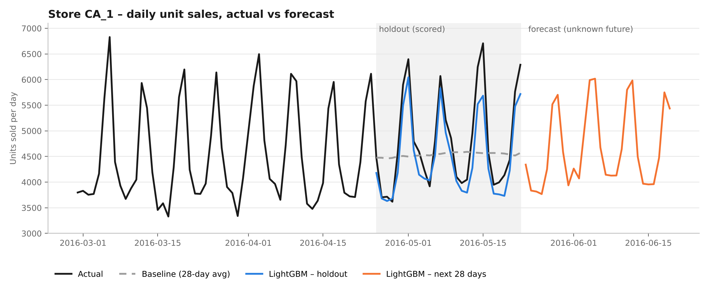
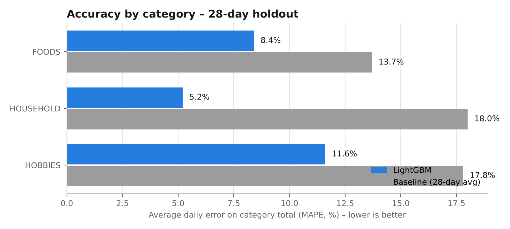
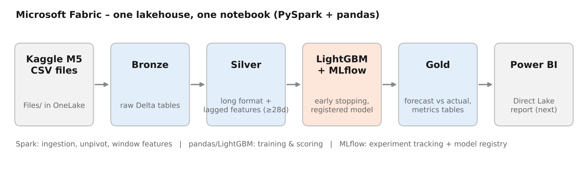
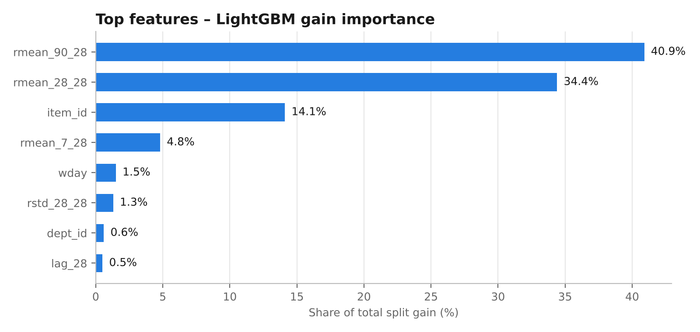

# Walmart M5 Demand Forecasting on Microsoft Fabric

Forecasts daily unit sales for **every item in a Walmart store, 28 days ahead**, using the public
[M5 Forecasting dataset](https://www.kaggle.com/competitions/m5-forecasting-accuracy). Built end to end on
Microsoft Fabric: Delta lakehouse (bronze / silver / gold), PySpark features, LightGBM, and MLflow
experiment tracking and model registry.



## Results (store CA_1, 28-day holdout: 25 Apr – 22 May 2016)

| Metric | LightGBM | Baseline (28-day average) |
|---|---|---|
| RMSE (item-day) | **2.256** | 2.422 |
| MAE (item-day) | **1.148** | 1.205 |
| Average daily error on store total (MAPE) | **6.1%** | 14.1% |

* The model cuts the store-level daily error by **57%** compared with a 28-day moving average.
* Every category improves: Household 5.2% vs 18.0%, Foods 8.4% vs 13.7%, Hobbies 11.6% vs 17.8%.
* Known weakness: the forecast is **~6% below actual volume** across the holdout (systematic under-forecast).



## Pipeline



| Layer | Table | Contents |
|---|---|---|
| Bronze | `bronze_sales`, `bronze_calendar`, `bronze_prices` | Raw M5 CSVs as Delta tables |
| Silver | `silver_features` | One row per item per day + calendar, price and lag features |
| Gold | `gold_forecast` | Actual vs forecast for every item-day (holdout + next 28 days) |
| Gold | `gold_model_metrics` | RMSE / MAE / daily-total MAPE for model and baseline |

**Model artefacts:** MLflow experiment `walmart_m5_forecast`, registered model `walmart_m5_lgbm` (v1),
and a portable copy `Files/models/walmart_m5_lgbm.txt` (LightGBM native text format; loads anywhere with
`lgb.Booster(model_file=...)`).

## Key design choices

1. **No leakage over a 28-day horizon.** Every sales feature is shifted by at least 28 days
   (`lag_28/35/42`, rolling means/std over windows ending 28 days back). One model therefore forecasts the
   full 4-week horizon using only information available at forecast time.
2. **Tweedie objective.** Most items sell 0–2 units a day; Tweedie handles the many zeros better than
   plain squared error.
3. **Early stopping on the holdout.** Validation RMSE was best at **104 trees**; the final model is
   retrained on all known days with that number of trees.
4. **A baseline to beat.** Each item's average daily sales over the 28 days before the forecast window,
   logged to the same MLflow experiment.



## How to run

1. In a Fabric workspace, create a lakehouse and upload `calendar.csv`, `sales_train_evaluation.csv` and
   `sell_prices.csv` to its `Files/` root (or upload `kaggle.json` and the notebook downloads them).
2. Import `notebook/walmart_m5_forecast.ipynb`, attach the lakehouse as default, and **Run all**.
3. Change `STORES = ["CA_1"]` in the first cell to scale to more stores.

Runtime on an F2 capacity: about 10 minutes for one store.

## Limitations and next steps

* One store of ten; scale out with the `STORES` setting.
* ~6% under-forecast: tune the Tweedie variance power, add trend features.
* Scored with RMSE / MAE / MAPE, not the official M5 metric (WRMSSE).
* One holdout window: add rolling-origin back-tests.
* Power BI report on the gold tables (Direct Lake); AWS version of the same pipeline.

## Repository contents

```
notebook/   walmart_m5_forecast.ipynb      Fabric notebook (full pipeline)
results/    *.csv                          Metrics, daily totals, category accuracy, feature importance
images/     *.png                          Charts and architecture diagram
```

Author: Niten Kadel, MSc Business Analytics & Data Science, EU Business School Munich
